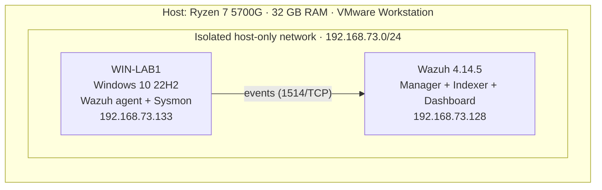

# SOC Home Lab: Wazuh + Sysmon

A home Security Operations Center (SOC) lab where I monitor a Windows 10 endpoint with **Wazuh SIEM** and **Sysmon**, triage the alerts it generates, and document every investigation the way a SOC analyst would: evidence, analysis, verdict, and tuning recommendations.

> 🇪🇸 Spanish summary: laboratorio SOC casero con Wazuh y Sysmon, con triage de alertas documentado.

## 🗺️ Architecture

| Machine | Role | OS | Resources | IP |
|---|---|---|---|---|
| Wazuh | SIEM (manager, indexer, dashboard) | Amazon Linux 2023 (official OVA) | 8 GB · 4 vCPU | 192.168.73.128 |
| WIN-LAB1 | Monitored endpoint | Windows 10 22H2 x64 | 4 GB · 2 vCPU | 192.168.73.133 |

## 🧱 Design decisions

- **Isolated network.** All lab machines share a host-only network with no internet access. Attacks and malware tests stay inside the lab. The Wazuh NAT adapter is disconnected during normal use.
- **Telemetry: Sysmon + SwiftOnSecurity config.** Default Windows logs miss key details such as full command lines and process GUIDs. Sysmon v15 adds them, using a well-known community configuration as the baseline.
- **Clean endpoint.** The first Windows VM had software from an unverified source installed, so I rebuilt it from a clean ISO instead of trusting it. "Absence of evidence is not evidence of absence."
- **Snapshots with the VM powered off.** This avoids large memory files and gives a clean restore point before every test.

## 🔍 Investigations

| ID | Date | Rule | Verdict | Key lesson |
|---|---|---|---|---|
| [TRIAGE-001](triage-notes/2026-10-11-WIN-LAB0-rule-92031.md) | 2026-10-11 | 92031: Discovery activity (T1087.001) | False positive | The Wazuh agent itself runs `net user` at startup: the monitoring tool can trigger its own alerts. |
| [TRIAGE-002](triage-notes/2026-10-15-WIN-LAB1-rule-92213.md) | 2026-10-15 | 92213: Script created in Temp (T1105) | False positive | Wazuh stores alerts, not every event: the parent process was only visible in the local Sysmon log, correlated by `ProcessGuid`. |

Every note follows the same template: metadata, scope, summary, evidence (process tree, key fields, checks), analysis, verdict, actions, **proposed tuning and its risk**.

## 🛠️ Troubleshooting log

Real problems I hit while building the lab:

- **Silent agent install failure:** `msiexec` runs asynchronously, so the first install "finished" without installing anything. Fixed with `Start-Process -Wait -PassThru` and checking the exit code.
- **Dashboard unreachable from the host:** the VPN client on the host blocked local network traffic (LAN access is a paid feature). Diagnosed with `Test-NetConnection` and `Find-NetRoute`; the VPN is disconnected while using the lab.
- **Blind spot in the SIEM:** process creation events (Sysmon Event ID 1) that do not match a rule are not stored in the alerts index. Documented in TRIAGE-002; enabling Wazuh archives is a planned improvement.

## 🚧 Roadmap

- [x] Wazuh + Sysmon on an isolated network
- [x] First documented investigations
- [ ] Kali attacker VM on the isolated network
- [ ] Active Directory domain controller
- [ ] Simulated attacks with Atomic Red Team, mapped to MITRE ATT&CK
- [ ] Custom detection rules (detection-as-code)
- [ ] AI-assisted triage: compare AI models against my own investigations
- [ ] Endpoint hardening from the CIS Benchmark baseline (currently 25% compliant per Wazuh SCA)

## 👤 Author

**Jonny Lobo**: IT infrastructure & security specialist moving into SOC / Blue Team. [GitHub profile](https://github.com/JonnyLobo)
